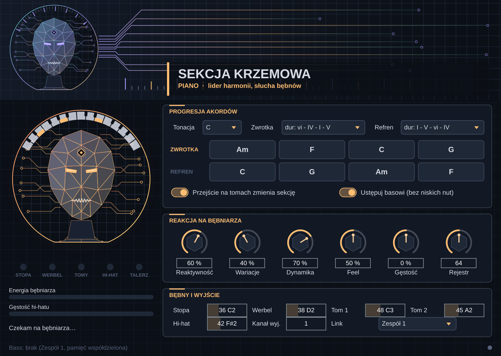

# Sekcja Krzemowa

Dwie wtyczki MIDI (VST3 + AU, macOS Apple Silicon) dla REAPER-a, które grają
z bębniarzem na żywo:

- **Sekcja Krzemowa Piano** słucha bębnów (stopa, werbel, 2 tomy, hi-hat) i gra
  popowy akompaniament fortepianu. To ona jest liderem harmonii: tu wybierasz
  tonację i progresje akordów zwrotki i refrenu.
- **Sekcja Krzemowa Bass** słucha bębnów **i** instancji Piano. Progresję
  pobiera automatycznie, trzyma się stopy i dopełnia rytm Piano.

Tempo i metrum pochodzą z projektu REAPER-a (bębniarz gra do klika).
Wtyczki nie dodają opóźnienia (latencja 0 próbek).



## Pobranie

Każdy push na `main` buduje wtyczki w GitHub Actions (macOS 14, Apple Silicon,
plik universal arm64 + x86_64). Gotowy plik `SekcjaKrzemowa-macOS.zip` znajdziesz
w zakładce **Actions → Build macOS → Artifacts** (a po otagowaniu `v*` także w
**Releases**). Instalacja: [docs/INSTALACJA.txt](docs/INSTALACJA.txt).

## REAPER krok po kroku

1. **Ścieżka „Bębny”**: wejście MIDI z perkusji elektronicznej, uzbrojona do
   nagrywania z monitoringiem, na niej Twój instrument perkusyjny.
2. **Ścieżka „Piano”**: FX: `Sekcja Krzemowa Piano` → Twój instrument piano.
3. **Ścieżka „Bass”**: FX: `Sekcja Krzemowa Bass` → Twój instrument basowy.
4. Na ścieżce Bębny dodaj **wysyłki (Sends)** do Piano i do Bass:
   audio `None`, MIDI `All → All`.
5. Włącz metronom i transport. Instrumenty wchodzą na najbliższym bicie po
   tym, jak bębniarz zacznie grać.
6. Jeśli Twoja perkusja wysyła inne numery nut niż General MIDI, ustaw je w
   panelu **Bębny i wyjście** (stopa, werbel, tom 1, tom 2, hi-hat). Aliasy GM
   (np. 35/36 stopa, 42/44/46 hi-hat, 49/57 crash) są rozpoznawane zawsze.
7. Piano i Bass muszą mieć ten sam **Link** (Zespół 1–4). Kilka zespołów w
   jednym projekcie nie przeszkadza sobie nawzajem.

Uwaga: REAPER domyślnie przetwarza ścieżki „z wyprzedzeniem” (anticipative FX).
Ścieżki zasilane z uzbrojonej ścieżki z monitoringiem powinny iść w czasie
rzeczywistym. Jeśli mimo to usłyszysz opóźnienie reakcji, uzbrój także ścieżki
Piano i Bass z monitoringiem (wejście MIDI może być dowolne lub żadne).

## Jak gra

| Bębniarz robi | Sekcja reaguje |
| --- | --- |
| gęstszy hi-hat, mocniejszy werbel, więcej uderzeń | w następnym takcie wybiera gęstsze, mocniejsze licki |
| gra ciszej | niższa dynamika nut od razu (bieżące uderzenia) |
| gra przed / za bitem | nuty przesuwają się tak samo (gałka **Feel**) |
| przejście na tomach w drugiej połowie taktu | Piano milknie do końca taktu, Bass gra tylko na bitach |
| przejście na tomach | od następnego taktu zmiana sekcji: zwrotka ↔ refren, akcent na „raz” |
| takt ciszy | sekcja trzyma akord |
| dłuższa cisza | sekcja czeka i wchodzi razem z bębniarzem |
| wzór stopy | Bass wybiera licki trafiające w stopę (gałka **Trzymaj stopę**; od 75 % dogrywa prymę na każdą stopę) |

Gałki: **Reaktywność** (jak szybko energia podąża za bębniarzem), **Wariacje**
(jak często zmieniać lick: co 4, 2 lub 1 takt, i ile losowości), **Dynamika**,
**Feel**, **Gęstość** (przesunięcie energii), **Rejestr** (Piano),
**Oktawa** i **Trzymaj stopę** (Bass).

## Architektura

```
 e-perkusja ──MIDI──► ścieżka Bębny ──send──┬──► [Sekcja Krzemowa Piano] ──MIDI──► instrument piano
                                            │          │  publikuje: progresję, sekcję i akord taktu,
                                            │          │  rytm swojego taktu, energię
                                            │          ▼
                                            │   pamięć współdzielona (POSIX shm, bez blokad)
                                            │          │  ▲ Bass publikuje tylko „jestem”
                                            │          ▼  │
                                            └──► [Sekcja Krzemowa Bass] ──MIDI──► instrument basowy
```

Każda instancja w każdym bloku audio:

1. Zamienia uderzenia bębnów na pozycje w takcie (ppq z transportu hosta) i
   liczy cechy taktu: gęstość hi-hatu, wzór stopy, siłę werbla, tomy, odchylenie
   od siatki (`Source/Core/DrumAnalyzer.h`).
2. Na granicy taktu zamyka poprzedni takt i decyduje o następnym: akord z
   progresji, sekcja, lick dobrany do energii bębniarza
   (`Source/Core/Engine.cpp`).
3. Lick (jeden takt w siatce 16-tek) jest przenoszony na bieżący akord
   z gwarancją braku zgrzytów: każda nuta to składnik akordu albo dźwięk skali,
   który nie leży półton od składnika (`remapInterval` w `Harmony.h`).
4. Nuty są wysyłane z dokładnością do próbki, bo przyszłe pozycje siatki znamy
   z transportu. Nie ma bufora wyprzedzenia, więc nie ma dodatkowej latencji.

Wszystko w wątku audio jest bez alokacji i bez blokad.

### Dlaczego licki z danych, a nie model ML w czasie rzeczywistym

Model generatywny (np. transformer na Lakh/Groove MIDI) dawałby więcej
różnorodności, ale kosztem nieprzewidywalnego czasu inferencji, ryzyka
„dziwnych” nut i trudnej kontroli harmonii między dwoma instrumentami.
Tutaj „wiedza” z danych jest wyekstrahowana offline do biblioteki licków
(prawdziwe popowe frazy z POP909), a w czasie rzeczywistym działa tylko wybór
i transpozycja, czyli stały, mikrosekundowy koszt. Harmonia jest
deterministyczna (wspólna progresja), więc dwa instrumenty nie mogą się
rozjechać.

### Dlaczego nie ma pętli sprzężenia zwrotnego

- Przepływ jest jednostronny: Piano → Bass. Piano nie słucha nut basu, wie
  tylko, że Bass istnieje (wtedy nie schodzi poniżej E3).
- Decyzje zapadają raz na takt i opierają się na **zamkniętym** poprzednim
  takcie, nigdy na tym, co druga instancja zagrała przed chwilą.
- Gdy Bass zdecyduje o takcie przed Piano (REAPER przetwarza ścieżki
  równolegle), przewiduje sekcję tą samą regułą z tych samych bębnów, a jeśli
  Piano opublikuje inną decyzję w pierwszej połowie taktu, Bass się poprawia.

## Biblioteka licków

`Source/Core/LickLibraryData.h` jest generowany przez
`tools/extract_licks.py` z **POP909** (909 popowych piosenek z adnotacją
akordów i bitów, licencja MIT). Z 31 049 taktów 4/4 z jednym akordem wybrano
644 licki piano i 451 licków basu, równomiernie rozłożonych po energii,
z deduplikacją i limitem licków z jednej piosenki. POP909 nie ma ścieżki basu,
więc linia basu pochodzi z najniższych dźwięków lewej ręki aranżacji
fortepianowej.

Skrypt obsługuje też **Lakh MIDI** (`clean_midi`, filtr artystów pop,
prawdziwe ścieżki basowe GM 32–39, akordy wnioskowane z pozostałych ścieżek).
Lakh zawiera materiał chroniony prawem autorskim, więc taką bibliotekę traktuj
jako prywatną i nie rozpowszechniaj zbudowanych z nią wtyczek.

```bash
pip install mido
git clone https://github.com/music-x-lab/POP909-Dataset
python3 tools/extract_licks.py --pop909 POP909-Dataset/POP909 [--lakh ~/lmd/clean_midi]
```

## Budowanie samodzielnie

Wymagania: CMake ≥ 3.22, Xcode (Command Line Tools). JUCE 8.0.4 pobiera się
samo.

```bash
cmake -S . -B build -DCMAKE_BUILD_TYPE=Release -DCMAKE_OSX_ARCHITECTURES="arm64;x86_64" -DSK_COPY_PLUGINS=ON
cmake --build build --config Release --parallel
./build/sk_core_tests
```

Opcja `-DSK_BUILD_HOST_TEST=ON` buduje dodatkowo test ładujący VST3 w hoście
JUCE i narzędzie do zrzutów ekranu edytora.

## Struktura

```
Source/Core/     rdzeń bez JUCE: Engine, DrumAnalyzer, Harmony, SharedLink, biblioteka licków
Source/Plugin/   procesor i edytor JUCE (wspólny kod, rola z SK_ROLE_BASS)
Resources/       grafiki istot krzemowych (SVG)
tools/           ekstrakcja licków, generator grafik
tests/           testy rdzenia (symulacja jamu), test w hoście, zrzuty GUI
```

## Ograniczenia i dalsze kroki

- Licki są jednotaktowe w 4/4. Inne metrum działa (licki są przycinane lub
  powtarzane), ale brzmi najlepiej w 4/4.
- Jeden akord na takt.
- Planowane: tryb „podążaj za bębniarzem” (wykrywanie tempa zamiast klika).
